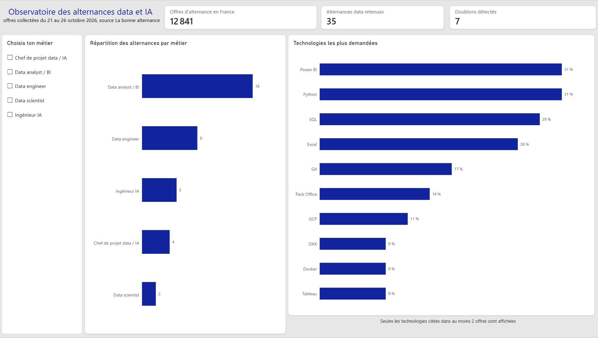

# Observatoire des alternances data et IA

Quelles technologies apprendre pour décrocher une alternance en data ou en IA ? Plutôt que de deviner, ce projet va chercher la réponse directement dans les offres. Il récupère toutes les offres d'alternance publiées en France, isole celles qui concernent la data et l'IA, les fait analyser par un modèle de langage, puis présente les technologies les plus demandées pour chaque métier dans un dashboard Power BI.



## Les résultats

Sur les offres collectées du 21 au 26 octobre 2026, 35 alternances data et IA ont été retenues parmi environ 12 800 offres d'alternance actives en France.

Trois compétences dominent nettement. Power BI et Python sont demandés dans 31 % des offres, SQL dans 29 %, puis Excel dans 26 %.

Le détail par métier est plus parlant encore. Pour une alternance de data analyst ou de BI (16 offres), Excel et Power BI sont demandés dans la moitié des offres, loin devant SQL (31 %) et Python (25 %). Pour le data engineering (8 offres), les outils de développement passent devant, avec Git dans la moitié des offres puis Docker, GCP et Python. Pour les postes d'ingénieur IA, les outils cités sont très dispersés (LangChain, OpenAI, Gemini, PyTorch...), chacun dans une seule offre, signe d'un domaine encore jeune sans boîte à outils standard.

Ces chiffres sont une photographie sur un petit échantillon, pas une vérité sur tout le marché. La section « Les limites » détaille pourquoi.

## Comment ça marche

Le projet est un pipeline en cinq étapes, un script Python par étape.

### 1. Extraction

`src/extract_lba.py` interroge l'API de "La bonne alternance", le service public qui centralise les offres d'alternance en France. La route d'export renvoie un lien signé valable deux minutes, vers un fichier JSON. Il est téléchargé en streaming par morceaux de 1 Mo, dans un fichier temporaire renommé seulement à la fin, pour qu'un téléchargement interrompu ne laisse jamais de fichier corrompu.

### 2. Pré-filtre et déduplication

`src/explore.py` lit chaque export avec `ijson`, sans charger le fichier entier en mémoire. Sur les 295 000 lignes d'un export, 96 % sont des entreprises proposées pour des candidatures spontanées, pas de vraies offres. Il reste environ 12 800 offres, dont une soixantaine passent le pré-filtre, basé sur un motif dans le titre (data, BI, IA, machine learning...) et sur douze codes ROME des métiers du numérique et de la data.

La même offre est souvent publiée sur plusieurs sites (Hellowork, Meteojob, Direct Emploi...), avec un identifiant différent à chaque fois. La déduplication découpe chaque description en morceaux de cinq mots, et considère comme doublons deux offres dont la plus courte description se retrouve à plus de 80 % dans l'autre. Les textes sont d'abord normalisés (accents, apostrophes typographiques, ligatures), sinon deux copies identiques mais encodées différemment ne seraient pas reconnues.

### 3. Analyse par IA

`src/analyse_ia.py` envoie chaque offre à Claude Haiku, qui renvoie un JSON indiquant s'il s'agit vraiment d'un poste data, le métier, les technologies citées et le type de contrat réel (certaines « alternances » sont en fait des stages). Le prompt est versionné, et seules les offres jamais analysées avec la version actuelle sont envoyées au modèle. L'analyse d'une journée coûte quelques centimes.

### 4. Statistiques

`src/statistiques.py` harmonise les noms de technologies (Git et GitHub, PowerPoint et Word regroupés en Pack Office...), compte les technologies au global et par métier, puis exporte deux fichiers CSV pour Power BI.

### 5. Dashboard

Le dashboard Power BI repose sur un modèle en étoile simple, une table des offres et une table des technologies par offre, liées par l'identifiant. Un sélecteur de métier filtre les technologies, et une mesure DAX calcule la part des offres qui demandent chaque technologie.

## Les choix de méthode

Le pré-filtre privilégie le rappel. Il ratisse large et laisse l'IA écarter les faux positifs. Sur les 63 offres uniques pré-filtrées, l'IA en a écarté près de la moitié (commerciaux, assistants de gestion, postes de développement où l'IA n'est qu'un atout).

La règle donnée au modèle est « en cas de doute, réponds non ». L'observatoire préfère rater quelques offres limites plutôt que compter des postes qui ne sont pas vraiment data.

Les catégories data analyst et BI sont fusionnées dans les statistiques, car le modèle les distinguait mal, comme les recruteurs eux-mêmes.

Un métier n'est détaillé qu'à partir de 5 offres, et une technologie n'entre dans un classement que si elle est citée au moins deux fois, pour éviter les classements au hasard entre ex aequo.

## Les limites

L'échantillon est petit. Avec 35 offres, une seule offre représente environ 3 %, et cinq offres de plus ont suffi à faire passer SQL de la cinquième à la troisième place.

L'export ne contient que les offres actives. Une offre pourvue ou expirée disparaît et ne peut plus être récupérée, d'où l'intérêt de collecter régulièrement.

Le pré-filtre repose sur le titre. Une offre au titre vague (« Chargé de mission ») qui demande pourtant des compétences data peut être manquée.

Les codes ROME sont parfois mal attribués par les recruteurs, avec par exemple des postes commerciaux classés en développeur décisionnel.

Le modèle de langage n'est pas parfaitement déterministe sur les cas limites. Deux descriptions identiques ont déjà reçu deux classifications différentes, ce qui a conduit à resserrer le prompt.

## Les prochaines étapes

Automatiser la collecte quotidienne, pour accumuler les offres au fil des semaines et rendre les chiffres plus fiables. Conserver pour chaque offre sa date de première et de dernière apparition, pour mesurer combien de temps une offre data reste en ligne. Étendre le pré-filtre aux descriptions, pour attraper les offres au titre vague.

## Lancer le projet

Il faut une clé d'API La bonne alternance et une clé d'API Anthropic, à placer dans un fichier `.env` à la racine, sous les noms `LBA_API_TOKEN` et `ANTHROPIC_API_KEY`.

```bash
pip install -r requirements.txt
python src/extract_lba.py
python src/explore.py
python src/analyse_ia.py
python src/statistiques.py
```

Les fichiers CSV sont écrits dans `data/export/`. Il suffit ensuite d'ouvrir le fichier Power BI du dossier `dashboard/` et de cliquer sur « Actualiser ».

## Structure

```
src/
  extract_lba.py      extraction de l'export La bonne alternance
  explore.py          pré-filtre et déduplication
  analyse_ia.py       classification des offres par Claude
  statistiques.py     statistiques et export CSV
dashboard/            fichier Power BI
docs/                 captures du dashboard
data/                 données brutes et traitées (non versionnées)
```

## Stack technique

Python (requests, ijson), API La bonne alternance, API Anthropic (Claude Haiku), Power BI et DAX.